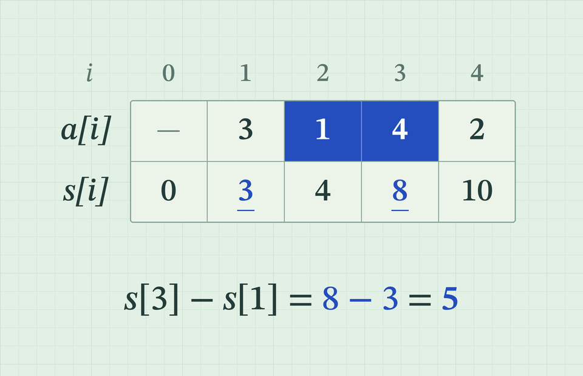

# zhw 的作品与笔记

一个用 Astro 和 Markdown 维护的中文个人网站。简历可以直接链接到某个项目或某篇笔记。每篇内容各有一个文件，修改标题或正文时可以一直沿用原地址。

## 本机预览

使用 Node.js 24（仓库的 `.nvmrc` 和 GitHub Actions 使用同一主版本）。首次克隆或更新依赖后，在仓库根目录运行以下命令，打开终端显示的本机地址。

```sh
npm ci
npm run dev
```

## 平时改哪里

| 想改的内容 | 文件或目录 |
| --- | --- |
| 署名、首页自我介绍、GitHub 链接、站点描述 | [src/lib/site.ts](src/lib/site.ts) |
| 项目标题、排序、技术栈和介绍 | [src/content/projects/](src/content/projects/) |
| 笔记标题、日期和正文 | [src/content/notes/](src/content/notes/) |
| 图片和可下载附件 | [public/media/](public/media/) 和 [public/files/](public/files/) |
| 配色、字号、间距和页面宽度 | [src/styles/global.css](src/styles/global.css) |

上传仓库后，也可以直接在 GitHub 打开对应的 Markdown 文件，用铅笔按钮编辑并提交。新增内容时，把[项目模板](templates/project.md)或[笔记模板](templates/note.md)复制到对应的内容目录，换成自己的文件名。模板里的示例日期也可以修改。

### 写一篇新内容

在本机可以用以下命令从模板新建文件。同名文件会得到提示。笔记会自动填入当天日期。

```sh
npm run new:project -- my-tool
npm run new:note -- prefix-sums
```

例如，第二行会创建 `src/content/notes/prefix-sums.md`。条目的标题、简介和排序来自文件开头两个 `---` 之间的信息，第二个 `---` 之后是正文。文件名适合用简短的小写英文、数字和连字符。保留文件名和目录即可保持简历里的链接有效。

1. 填好 `title`、一句话的 `summary` 和 `category`。笔记还需要 `date`，格式为 `YYYY-MM-DD`。
2. 保持 `draft: true` 写作。运行 `npm run dev` 后，在本机直接打开 `/notes/prefix-sums/` 或 `/projects/my-tool/` 看草稿。草稿仅在开发预览中有详情页，首页和列表只列成稿。公开仓库的源码可见，私密笔记请保存在仓库之外。
3. 写好后改成 `draft: false`。项目按 `order` 从小到大排，默认 100，首页取前两个。笔记按 `date` 从新到旧排，首页取最近三篇。相同排序值或日期按条目 ID 排列。
4. 运行 `npm run build` 检查。首页、列表、详情页和正文目录会自动生成。正文有两个或更多 `##` 标题时会显示折叠目录。

### 配图、附件与源码

图片放进 `public/media/`，附件放进 `public/files/`。在 Markdown 正文里用以 `/` 开头的站内路径。仓库名由构建过程补上，同一篇正文也可以用在独立域名。

```md

[五子棋项目](/projects/gomoku/)
[下载题单](/files/acm-guide.pdf)
```

在文件顶部填写素材时，路径从 `public/` 内部开始写，例如 `media/gomoku.webp`。以下字段都可按需添加。

| 内容 | 可选字段 |
| --- | --- |
| 项目 | `stack` 是技术栈列表，`repo` 是完整的源码仓库网址，`sourceDownload` 是可下载的本地源码包。`cover.path` 和 `cover.alt` 指定缩略图及其说明。 |
| 图像对照项目 | `comparison.original`、`comparison.compressed` 和 `comparison.alt` 指定两份样张和说明。详情页可以切换两张图，体积按实际文件计算。[ImgShift 示例](src/content/projects/imgshift.md) |
| 笔记 | `tags` 是标签列表，`cover` 用于分享卡片。`attachment` 和 `attachmentLabel` 指定附件及下载文字。PDF 会提供可展开的预览。[笔记示例](src/content/notes/acm-roadmap.md) |

## 检查发布版本

```sh
npm run build
npm run preview
```

`dist/` 是生成的静态站点。构建会检查页面中引用的站内地址、标题锚点、图片和下载文件。遇到无效链接时，终端会列出出错页面和目标地址。要在本机模拟仓库名为 `personal-site` 的路径，可以运行以下命令，再访问终端显示的 `/personal-site/` 地址。

```sh
BASE_PATH=/personal-site/ npm run build
BASE_PATH=/personal-site/ npm run preview
```

`SITE_URL` 可选，用正式来源地址（例如 `https://zhw-233.github.io`）生成规范链接和分享图片的完整地址。GitHub Actions 会从 Pages 设置读取正式地址和路径。

## 发布到 GitHub Pages

`main` 保存网站源码。把改动提交到本地 `main` 后运行 `git push`，GitHub Actions 会自动构建网站、检查站内链接，并在检查通过后把 `dist/` 部署到线上。直接在 GitHub 上提交到 `main` 也会触发同一流程。[线上网站](https://zhw-233.github.io/) · [部署记录](https://github.com/zhw-233/zhw-233.github.io/actions/workflows/pages.yml)

面向 `main` 的拉取请求会在 `/preview/` 路径下进行构建和链接检查。需要重新发布当前版本时，可在 **Actions → Portfolio Pages → Run workflow** 选择 `main`。[发布工作流](.github/workflows/pages.yml)

仓库的 **Settings → Pages → Build and deployment → Source** 使用 **GitHub Actions**。本地生成的 `dist/`、`node_modules/` 和 `.astro/` 已加入 Git 忽略列表。

## 现有素材

地形图是原创高度场渲染，页面对照的是 ImgShift 实际输出的两份 JPEG。五子棋源码包包含原项目的 `src/main.c`、MinGW 编译脚本和说明。ACM 题单 PDF 来自原题单工程。西文字体 Geist 随网站本地加载。[字体授权](public/licenses/Geist-OFL.txt)
